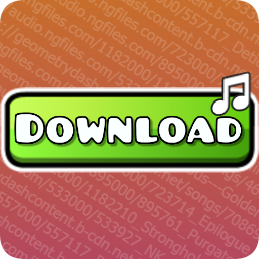
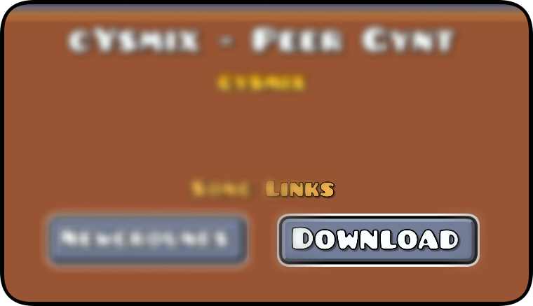

# ActuallyDownloadSoundtrack
Download Newgrounds song by direct link!

# About
This mod adds a button in the song info menu that let you download the song by *direct link*

# Examples
This works with newgrounds songs. [(Example)](https://audio.ngfiles.com/723000/723714_Epilogue.mp3)

Also including the songs that moved to Robtop's servers. (like [music by Acid-Notation](https://geometrydashcontent.b-cdn.net/songs/708694.mp3))

And it also works with music from Sound Library and NCS. [(Example)](https://geometrydashfiles.b-cdn.net/music/10011140.ogg)

### Warning
If it says "Failed to get song URL", just try again later. This happens when song data is still loading.